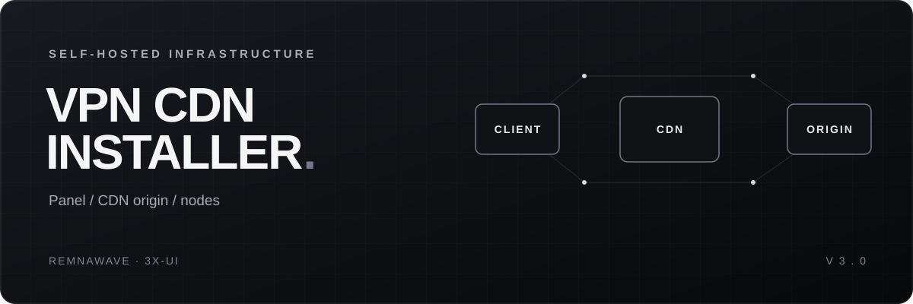

<!-- coderabbit-ai-generated:v1 -->

<!-- coderabbit-ai-generated-section:v1:cd7c4064dac3099dae12dced84d90a9387c40ea0f9465b105c3d53239836a29d -->

<!-- coderabbit-ai-generated:v1 -->

<!-- coderabbit-ai-generated-section:v1:3e5f63371be04bdf7a6b4995a5806123d4ee17c0a3d13f063be1e5051b8762bc -->

<p align="center">
  
</p>

<p align="center">
  <b>Панель, CDN и ноды — в одном установщике.</b><br>
  Выберите режим → настройте DNS и CDN → запустите свою инфраструктуру.
</p>

<p align="center">
  
  
  
  
</p>

---

**VPN CDN Installer** разворачивает Remnawave или 3x-ui, настраивает nginx как CDN-origin и помогает подключить ноды. Мастер работает без лицензионного ключа и использует встроенные настройки провайдеров.

```text
4 РЕЖИМА   /   6 CDN ДЛЯ REMNAWAVE   /   3 CDN ДЛЯ 3X-UI
```

## Возможности

- Панель и нода на одном сервере или нода на отдельном сервере.
- Подключение CDN-ноды к существующей панели и настройка каскада.
- Hysteria2, gRPC Reality и страница подписки Remnawave по выбору.
- Генерация конфигурации nginx, работа с DNS и сертификатами.
- Инструкция по переносу домена на TurboFlare и доступный откат при прерывании.

Для 3x-ui мастер предлагает gRPC Reality; Hysteria2 в этом сценарии не предлагается. Набор вопросов зависит от панели и режима.

## Перед запуском

Нужны **Ubuntu или Debian**, `apt-get`, `systemd`, **Python 3** и доступ root. Скрипт рекомендует Ubuntu 22.04 или 24.04; проверки кода выполнялись на Python 3.14. Сторонние пакеты Python не нужны: `requirements.txt` пустой, `pip install` и виртуальное окружение необязательны.

Подготовьте домен, доступ к DNS и выбранному CDN, доступ в интернет и, если нужны удалённые ноды или каскад, SSH-доступ к дополнительным серверам. Требуются TCP-порты 80 и 443; при выборе Hysteria2 и gRPC Reality — также UDP 8443 и TCP 2083. Проверьте сетевые правила сервера и хостинга.

Установщик изменяет системные настройки, DNS, nginx, файрвол и службы, может установить Docker и создать swap. Заранее сохраните нужные данные: откат по Ctrl+C учитывает только действия, отслеженные в текущем запуске.

## Быстрый запуск

Установите базовые инструменты на сервере, если их ещё нет:

```bash
sudo apt-get update
sudo apt-get install -y python3 curl git dnsutils
```

Клонируйте репозиторий и запустите мастер:

```bash
git clone https://github.com/cryals/cdn-installer.git
cd cdn-installer
sudo python3 main.py
```

<!-- coderabbit-ai-generated:v1 -->

<!-- coderabbit-ai-generated-section:v1:cf845e694c90642d863974062d79f8c6dea39f58c0c781060785c8537aeeff76 -->

<!-- coderabbit-ai-generated:v1 -->

<!-- coderabbit-ai-generated-section:v1:bed8bd5d27cafa807af4559f7fe2bedf70104fed5e96a3c9d24289d982117099 -->

Если вы скачали архив, распакуйте его, перейдите в папку, содержащую `main.py`, и выполните `sudo python3 main.py`.

<!-- /coderabbit-ai-generated:v1 -->

<!-- /coderabbit-ai-generated:v1 -->

Под root команда запуска — `python3 main.py`. Создайте DNS-записи, показанные мастером, затем продолжите установку. CNAME для CDN создаётся после настройки CDN по подсказкам мастера.

## Режимы

| Режим | Действие |
| --- | --- |
| **1** | Панель и нода на текущем сервере. |
| **2** | Панель на текущем сервере, нода на другом. В интерактивном мастере доступна Remnawave. |
| **3** | Добавление CDN-ноды к существующей панели Remnawave или 3x-ui. |
| **4** | Инструкция по переносу домена на TurboFlare; выбирается в меню. Аргумент `--mode 4` не поддерживается. |

<!-- coderabbit-ai-generated:v1 -->

<!-- coderabbit-ai-generated-section:v1:c87d430b0f35f69597084e17bc592c79a3ebf4f9a83cdfb390c2a381d9f2e771 -->

**Remnawave:** VK Cloud · Yandex Cloud · TurboFlare · Beeline/CDNvideo · Timeweb · Selectel

**3x-ui:** VK Cloud · Yandex Cloud · TurboFlare

<!-- /coderabbit-ai-generated:v1 -->

## Параметры

Параметры задают часть ответов заранее; в зависимости от режима могут остаться вопросы и ожидание DNS или CDN. Пример для Remnawave на одном сервере:

```bash
sudo python3 main.py --mode 1 --panel 1 --cdn vk --domain example.com --no-hy2 --no-grpc
```

Замените `example.com` на свой домен. Список всех аргументов:

```bash
sudo python3 main.py --help
```

Проверка root и `apt-get` выполняется до разбора аргументов, включая `--help`.

| Параметры | Назначение |
| --- | --- |
| `--mode {1,2,3}`, `--panel {1,2}` | Режим и панель: `1` — Remnawave, `2` — 3x-ui. |
| `--cdn`, `--domain` | Провайдер CDN и домен без схемы. |
| `--node-ip`, `--node-user`, `--node-key`, `--node-pass` | SSH-доступ к удалённой ноде в режиме 2. |
| `--panel-url`, `--panel-user`, `--panel-pass`, `--panel-ssh-user`, `--panel-ssh-pass` | Данные существующей панели для соответствующих вариантов режима 3. |
| `--no-hy2`, `--no-grpc`, `--no-subpage`, `--squad` | Дополнительные компоненты и сквад Remnawave. |
| `--origin-sub`, `--cdn-sub`, `--panel-sub`, `--exit-sub`, `--hy2-sub`, `--sub-sub` | Метки поддоменов. |
| `--cascade`, `--cascade-ip`, `--cascade-user`, `--cascade-pass` | Настройки каскада. |
| `--eu-grpc`, `--no-eu-grpc` | gRPC Reality на exit-сервере каскада. |
| `--youtube-direct`, `--no-youtube-direct` | Прямая маршрутизация YouTube и SoundCloud для каскада. |
| `--skip-dns-wait`, `--skip-cdn-wait` | Пропуск соответствующих подтверждений ожидания. |

Параметр `--api-token` устарел и игнорируется. Пароли в аргументах могут быть видны в истории команд и списке процессов; по возможности вводите их в интерактивном режиме или используйте SSH-ключ.

## Проверки

```bash
python3 -c "import ast; ast.parse(open('main.py').read())"
sudo nginx -t
sudo systemctl status nginx
```

Первая команда проверяет синтаксис скрипта без установки; команды nginx применимы после установки. Если выпуск сертификата или проверка DNS не проходит, проверьте записи, их распространение и доступность портов 80/443. Если удалённый сервер недоступен, проверьте IP, SSH-доступ и сетевые правила. Скрипт подключается по SSH без проверки ключа хоста; проверяйте адреса и доступ до запуска.

При Ctrl+C мастер предлагает отменить установку и выполнить доступный откат. После отката проверьте состояние сервера вручную.

## Файлы

<!-- coderabbit-ai-generated:v1 -->

<!-- coderabbit-ai-generated-section:v1:7d507e0968387cd0447cccffb728e09726a989d3f76243b90456c4bbf0ec7f95 -->

```text
main.py                      установщик
requirements.txt             зависимости Python
README.md                    инструкция
docs/assets/readme-cover.svg обложка
```

<!-- /coderabbit-ai-generated:v1 -->

## Стек

Python · Remnawave / 3x-ui · Xray · nginx · Docker · CDN

<!-- /coderabbit-ai-generated:v1 -->


<!-- /coderabbit-ai-generated:v1 -->